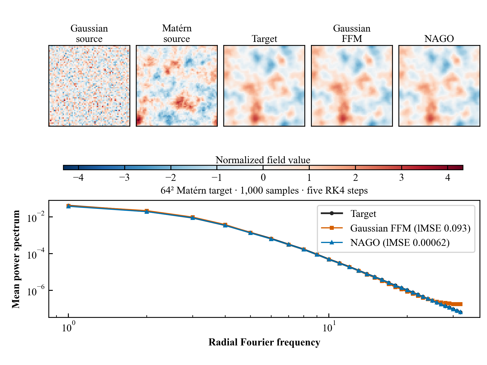
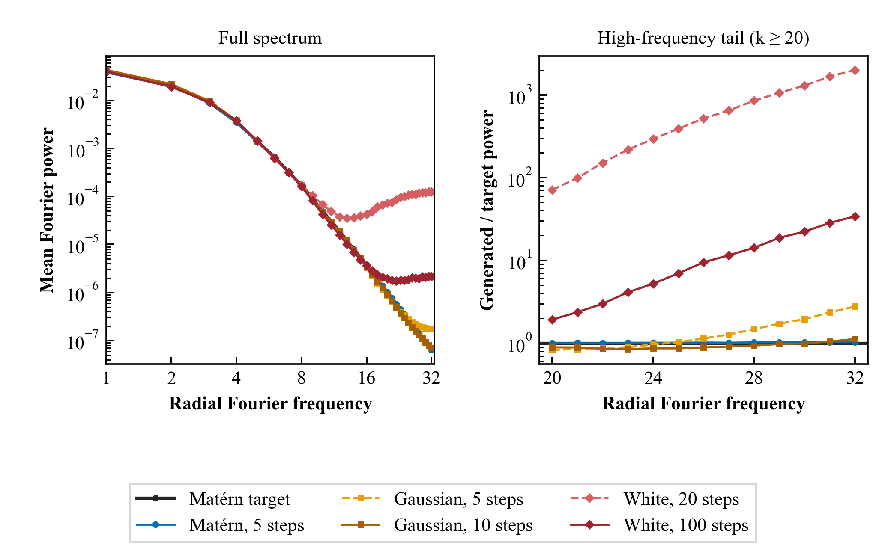
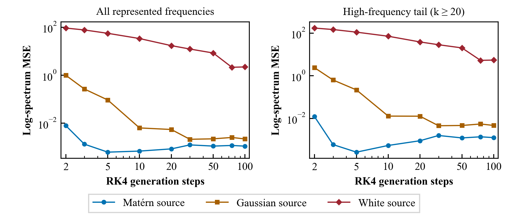
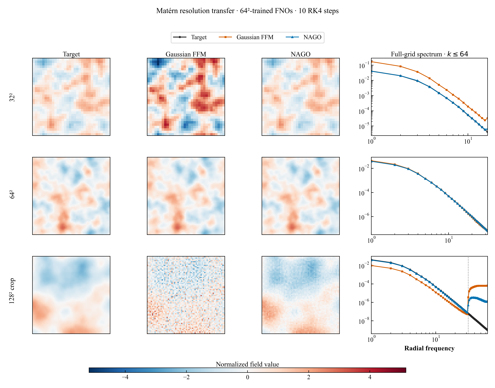
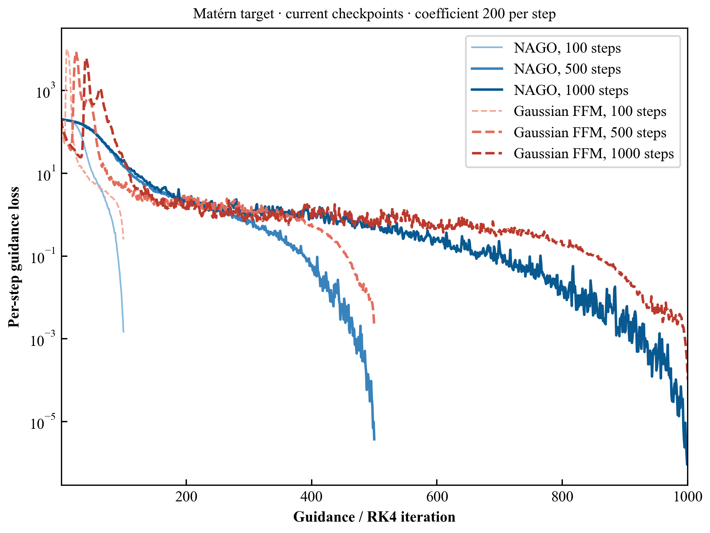
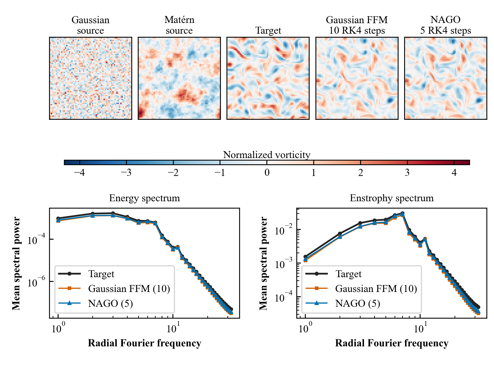
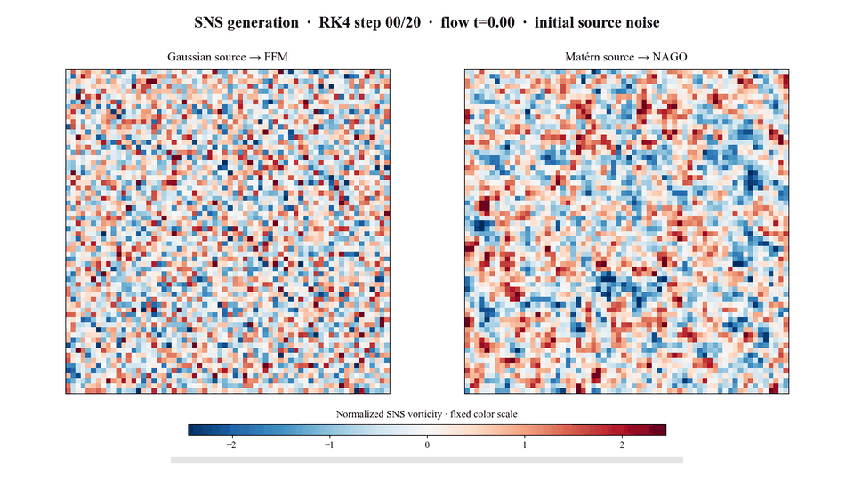
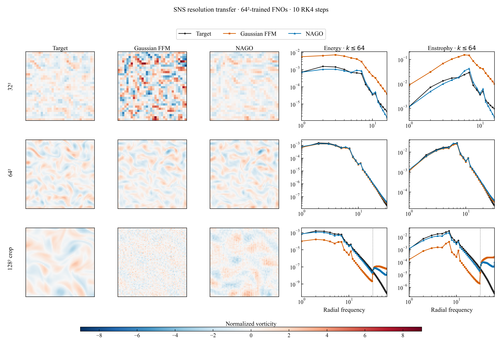
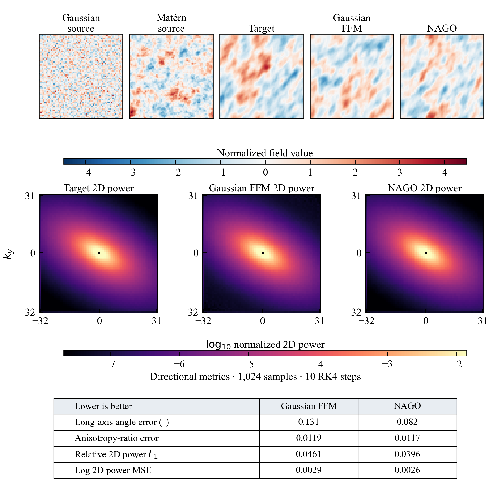

# NAGO: Theory and results

[← Repository overview and usage](README.md)

## Theory and insight

The source noise is part of the geometry of functional flow matching: it
changes the marginal velocity field even when the target distribution and
network are fixed. In function space, we first impose a sufficient
Cameron–Martin support condition on the target samples. If the target spectrum decays as $S_1(k)\sim |k|^{-\beta}$ in
$d$ dimensions, the paper gives the sufficient Matérn-source condition
$\nu_0<\beta/2-d$. For the two-dimensional Matérn target with $\nu_1=2$
and $\beta=6$, this requires $\nu_0<1$; our selected source has $\nu_0=0.5$.

**Our insight is to choose the source *within* that admissible set by matching
its covariance spectrum to the target over the Fourier modes the model can
represent.** The target-to-source spectral ratio
$\mu_k=S_1(k)/S_0(k)$ controls the frequency-dependent marginal velocity.
When the source has much more high-frequency energy than the target,
$\mu_k$ becomes small and the velocity develops a sharp negative excursion,
making the flow harder to learn and integrate. The analysis gives a concrete
design rule: choose an admissible source whose covariance stays close to
the target's over the resolved frequency band. This controls the magnitude
of the spectral velocity; our experiments show accurate spectra with fewer
solver steps. Smoothness, correlation length, amplitude, and the
resolved band all enter the source choice.

## Results

These panels show representative, unpaired field draws. Spectral curves and
power maps are averages over the stated evaluation sets; individual images
are not pointwise predictions of the adjacent target draw. The figure assets
are included here, while checkpoints and raw sample tensors stay outside Git.
The gallery follows the source-field → generated-field → distribution-level
spectrum comparison, then examines solver steps, resolution transfer, and a
directional target. Numerical gains depend on the benchmark and metric.
On the controlled Matérn target, source design substantially reduces the
RK4 budget for an accurate spectrum. Cross-resolution tests show improved
control of newly resolved energy without recovering an unseen target tail;
SNS and anisotropic-field comparisons have more metric-dependent outcomes.

### Matérn field

Both models use the same 64² FNO and five RK4 steps. The spectrum compares
1,000 generated fields per source with 1,000 target fields. The Gaussian
source is i.i.d. normal; the NAGO source is a correlated Matérn field with
`nu=0.5`, `ell=0.1`. The target has `nu=2`, `ell=0.1`.

#### Source distribution and RK4 steps

The main-paper Matérn ablation compares the target spectrum with generated
spectra from Matérn, i.i.d. Gaussian, and continuum white-noise sources.
The two panels below are a **current-checkpoint rerun** of that comparison:
the original plotted spectrum tensors and white-source checkpoint are no
longer available, so the white model was retrained for 4,000 steps. Each
source/step setting uses 1,000 generated 64² fields and the same 1,000-field
Matérn target reference.

  
  

For the high-frequency band `k>=20`, the Matérn source reaches a
log-spectrum MSE of `0.000599` at **3 RK4 steps**; Gaussian reaches `0.00458`
at **30 steps**. The white-source tail improves substantially between 20
and 100 steps, but its mean power at 100 steps is still **12.5×** the target.
The source with the better matched spectrum attains a low tail error at a
much smaller solver budget, consistent with the spectral-velocity analysis.

[The measured source-prior spectra](assets/matern_source_prior_spectra.png)
also expose a scale difference in this experiment: the i.i.d. Gaussian and
continuum white sources are both approximately flat-spectrum on the 64²
grid, but the latter has standard deviation about 63 rather than 1 because
of its `1/h` discretization. Their different step budgets therefore cannot
be attributed to roughness alone. The unit-scale Matérn-versus-Gaussian
comparison is a cleaner test of the regularity argument.

The same 64²-trained models were also evaluated at 32², 64², and 128² with
ten RK4 steps and 1,000 fields per distribution and resolution:

The 128² sample panels display only the central 64×64 crop, while its spectrum
uses the full 128² fields and shows radial frequencies only through `k=64`.
The dotted `k=32` boundary separates the shared and newly resolved bands.
NAGO suppresses spurious new-band energy relative to Gaussian FFM, but does
not recover the unseen fine-scale target spectrum accurately: its high-frequency
tail remains elevated relative to the target.

#### Guided reconstruction from partial observations

This **current-checkpoint rerun** uses a 64² Matérn target (`nu=2`,
`ell=0.1`), 25% observed grid sites, 100 samples per source and step count,
and the same per-step guidance coefficient **200** for all six curves. The
vertical axis is 200 times the mean observed-site MSE before each guidance
correction. Gaussian-source trajectories show a sharp early loss surge at
100, 500, and 1,000 RK4 steps; the Matérn-source trajectories decline
smoothly. The rerun reproduces the paper's qualitative guidance behavior
with the available checkpoints.

### Stochastic Navier–Stokes

The vorticity comparison uses 1,000 target and generated fields at 64².
NAGO uses five RK4 steps and Gaussian-source FFM uses ten, matching the
paper's selected operating points; this panel is **not an equal-compute
comparison**. The spectra are ensemble averages. The same evaluation also
reports distribution and physical-observable metrics, where the methods do
not have a uniform ranking.

The animation below follows one sample from each source through the learned
flow. Gaussian FFM and NAGO both use **20 RK4 steps** here, with independent
source draws and a shared fixed color scale. Each distinct frame is an actual
ODE state. The displayed $t$ is generative flow time, **not** physical
Navier–Stokes evolution time. This matched-step visualization is separate
from the five-step versus ten-step evaluation above.

The same 64²-trained checkpoints were separately evaluated at 32², 64², and
128² using **ten RK4 steps for both methods** and 256 fields per distribution
and resolution:

The 128² sample panels display a central 64×64 crop; energy and enstrophy
spectra use all pixels and show radial frequencies only through `k=64`.
The dotted line marks `k=32`. These transfer panels use a matched solver budget,
unlike the five-step versus ten-step overview above. The target fields come
from the cached 128² test set, with 32² and 64² targets bilinearly resized
from it. The ranking varies with evaluation resolution.

### Stationary anisotropic Matérn target

Both 64² models use ten RK4 steps and 1,024 generated samples. The target
has `nu=2`, `ell_x=0.1`, `ell_y=0.05`, and a 30-degree rotation; NAGO uses
an **isotropic** Matérn source. The full two-dimensional power spectrum
preserves directional information that radial averaging would hide. Both
sources recover the anisotropy; the measured advantage is modest and depends
on the metric and solver budget. The figure also reports long-axis angle,
anisotropy-ratio, and full 2D power-spectrum errors; lower is better for each.
